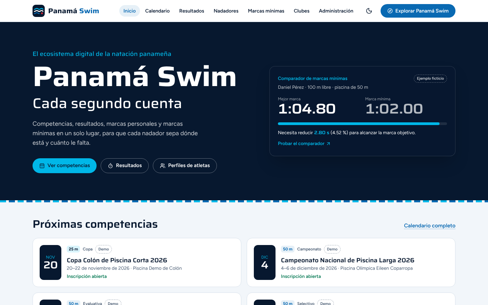
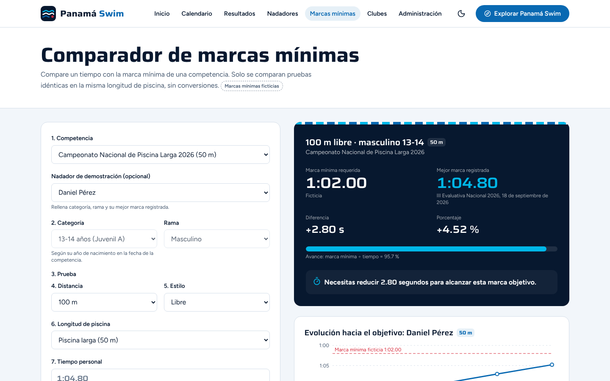
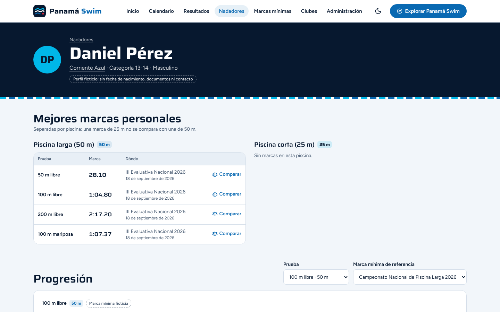
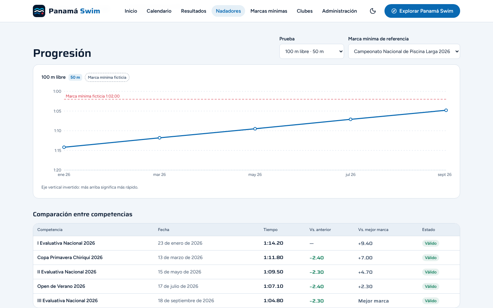
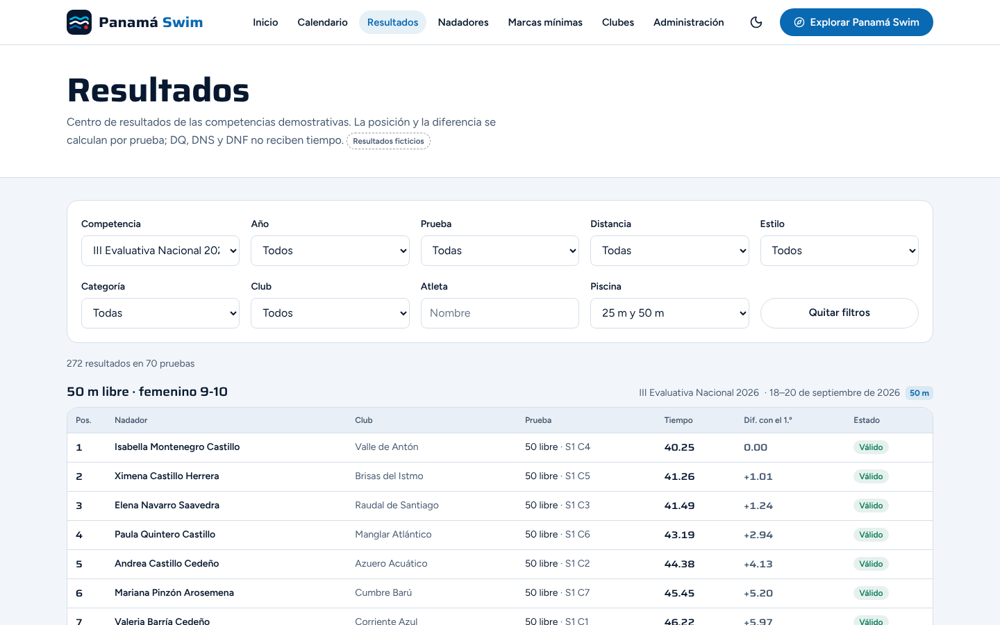
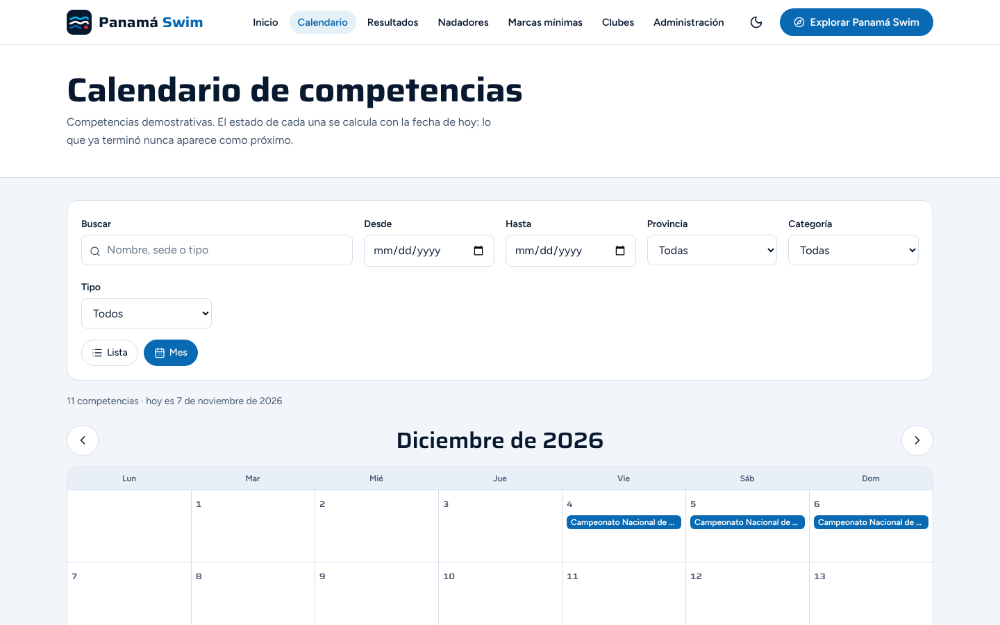
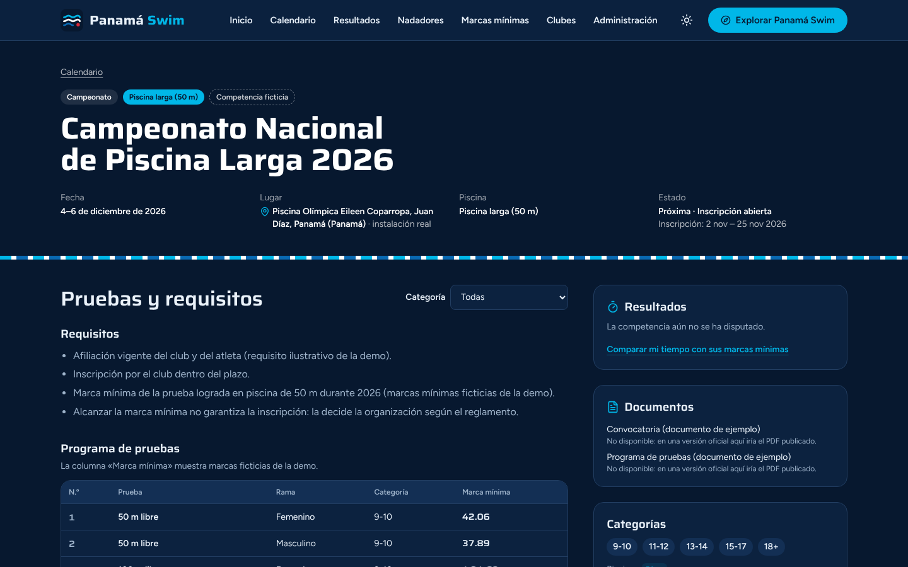
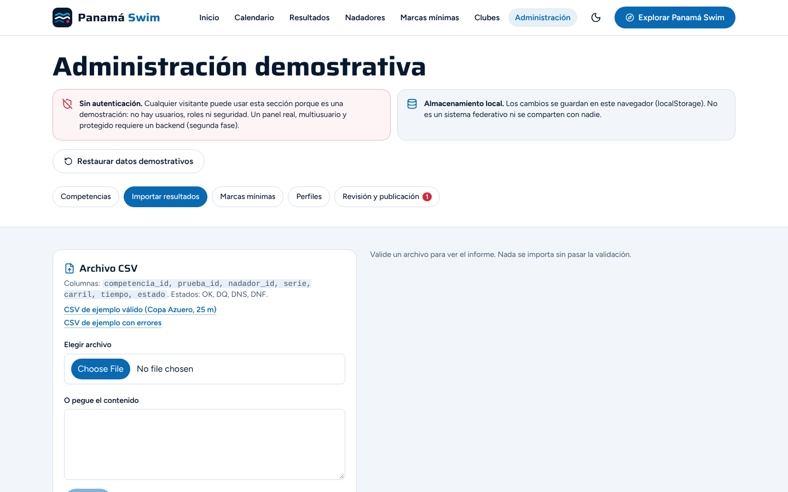
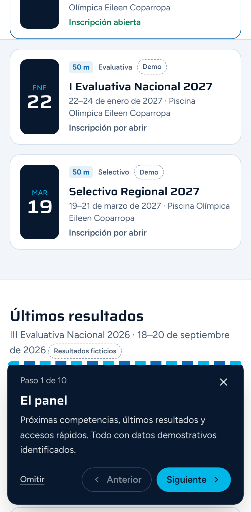

<p align="center">
  
</p>

<h1 align="center">Panamá Swim</h1>
<p align="center"><strong>Cada segundo cuenta.</strong><br/>El ecosistema digital de la natación panameña: competencias, resultados, marcas personales y marcas mínimas.</p>

<p align="center">
  <a href="https://charrixxz23.github.io/panama-swim-demo/">Demo</a> ·
  <a href="docs/documentacion-academica.md">Documentación académica</a> ·
  <a href="docs/fuentes-y-datos.md">Fuentes y datos</a> ·
  <a href="docs/pruebas.md">Pruebas</a>
</p>

> **Prototipo académico independiente inspirado en la natación panameña. No representa una plataforma oficial de la Federación Panameña de Natación.**
> Todos los atletas, clubes, competencias, resultados y marcas mínimas son **ficticios** y están identificados como tales en la interfaz.

**Demo:** https://charrixxz23.github.io/panama-swim-demo/ *(dirección prevista; se activa cuando el flujo de GitHub Pages termina)*



## La propuesta

Panamá Swim explora cómo la natación panameña podría tener un sistema de información deportiva integrado, en el que el flujo **competencia → nadador → historial → marca personal → marca mínima → comparación → progreso** funcione con datos estructurados en lugar de documentos separados.

Lo principal es que un atleta pueda consultar sus tiempos, descubrir competencias y saber exactamente cuánto le falta para una marca mínima, sin mezclar piscinas de 25 m y de 50 m y sin presentar una marca como clasificación oficial.

## Funcionalidades

| Módulo | Qué hace |
|---|---|
| **Inicio** | Héroe con el comparador en vivo, próximas competencias, últimos resultados, atletas destacados (ficticios), noticias verificadas de medios panameños y clubes. |
| **Calendario** | Vistas mensual y de lista; filtros por fechas, provincia, categoría y tipo; búsqueda. Lo vencido nunca aparece como próximo. |
| **Ficha de competencia** | Lugar, fechas, piscina de 25 o 50 m, categorías, programa de pruebas con marcas mínimas, requisitos, estado de inscripción calculado, documentos y resultados. |
| **Resultados** | Filtros por competencia, año, prueba, distancia, estilo, categoría, club, atleta y piscina. Posición, tiempo, diferencia con el primero y estado (válido, DQ, DNS, DNF) sin convertir estados en tiempos. |
| **Perfiles** | Mejores marcas separadas por piscina, progresión con eje invertido (menos tiempo es mejor), comparación entre competencias, historial y pruebas disputadas. Sin fechas de nacimiento ni contactos. |
| **Comparador de marcas mínimas** ⭐ | Competencia, categoría, prueba (distancia y estilo), piscina y tiempo. Muestra la marca requerida, la mejor marca registrada, la diferencia en segundos y en %, el estado y la evolución hacia el objetivo. |
| **Clubes y entrenadores** | Directorio con búsqueda y provincia, detalle con atletas, eventos y resultados agrupados, y una vista conceptual de entrenador. |
| **Administración demostrativa** | Crear y editar competencias, importar resultados CSV con validación completa, registrar marcas mínimas, gestionar perfiles ficticios, revisar y publicar, y restaurar los datos. Persistencia local, sin autenticación simulada. |
| **Recorrido «Explorar Panamá Swim»** | 10 pasos sobre componentes reales, con Siguiente, Anterior, Omitir y Finalizar; funciona en móvil y no bloquea la interfaz al terminar. |
| **Transversal** | Modo claro y oscuro, diseño adaptable, accesible con teclado, estados de carga, vacío y error, 404 propia, favicon, manifiesto e imagen para redes. |

## Capturas

Tomadas de la compilación de producción servida como en GitHub Pages, con la fecha fijada en el 7 de noviembre de 2026.

| | |
|---|---|
|  |  |
|  |  |
|  |  |
|  |  |

> En el entorno donde se tomaron, las fotografías de Unsplash no estaban accesibles y se ve el fondo de agua de respaldo. En el sitio publicado se cargan. Para regenerarlas: `node scripts/screenshots.mjs https://charrixxz23.github.io/panama-swim-demo/`.

## Tecnologías

React 18 · Vite 6 · TypeScript (estricto) · Tailwind CSS 3 · React Router 7 · Recharts · Lucide · Saira y Figtree · Vitest + Testing Library · Playwright · GitHub Actions + GitHub Pages.

Sin backend, sin claves y sin dependencias de pago.

## Arquitectura

```
src/
├── models/      Tipos del dominio (tiempos en milisegundos enteros)
├── services/    Lógica pura: calendario, ranking, marcas mínimas, CSV, consultas, repositorio
├── hooks/       useData (estado + acciones), useTheme, usePageMeta, useToday
├── data/        demo-dataset.json (sintético), referencias verificadas, plantillas, recorrido
├── utils/       Tiempos (parse/format), fechas en hora de Panamá, etiquetas, texto
├── components/  Cabecera, pie, recorrido, gráfica, insignias, estados
├── layouts/     Estructura común con manejo de errores y carga diferida
├── pages/       Una página por ruta
└── styles/      Variables de color (claro/oscuro) y componentes CSS
```

Diagramas de componentes, modelo de datos y flujos: [docs/documentacion-academica.md](docs/documentacion-academica.md).
La persistencia está detrás de la interfaz `DataRepository`, así que pasar a una API con PostgreSQL no requiere cambiar las pantallas.

## Instalación y ejecución local

Requisitos: Node.js 20 o 22 y npm.

```bash
git clone https://github.com/charrixxz23/panama-swim-demo.git
cd panama-swim-demo
npm ci
npm run dev        # http://localhost:5173/panama-swim-demo/
```

| Comando | Para qué |
|---|---|
| `npm run build` | Compila en `dist/` (incluye `404.html` para las rutas internas en GitHub Pages) |
| `npm run preview` | Sirve `dist/` igual que GitHub Pages: http://localhost:4173/panama-swim-demo/ |
| `npm run data` | Regenera los datos sintéticos y los CSV de ejemplo |

## Pruebas

```bash
npm run typecheck
npm test                                        # Vitest: tiempos, comparador, ranking, calendario, CSV, datos, persistencia
npx playwright install chromium && npm run test:e2e   # escritorio, tableta, Android e iPhone (emulados en Chromium)
```

Resultados de la última ejecución y lo que no se pudo verificar: [docs/pruebas.md](docs/pruebas.md).

## Despliegue

`.github/workflows/deploy.yml` instala, verifica tipos, ejecuta las pruebas unitarias y de navegador, compila y publica en GitHub Pages en cada *push* a `main`. Detalle: [docs/despliegue.md](docs/despliegue.md).

## Accesibilidad (referencia WCAG 2.2 AA)

| Combinación de colores | Contraste |
|---|---|
| Texto principal sobre fondo (claro y oscuro) | 16,4 : 1 y 15,7 : 1 |
| Texto secundario sobre fondo | 6,6 : 1 (claro) y 7,6 : 1 (oscuro) |
| Azul océano sobre blanco (enlaces y botones) | 5,7 : 1 |
| Azul piscina sobre marino (modo oscuro) | 7,6 : 1 |
| Rojo de alerta sobre blanco y sobre marino | 5,0 : 1 y 5,8 : 1 |

También incluye foco visible, objetivos táctiles de al menos 44 px, etiquetas en todos los campos, resultados anunciados con `aria-live`, gráficas con descripción textual, enlace para saltar al contenido y respeto de `prefers-reduced-motion`.

## Créditos

- Desarrollo: [charrixxz23](https://github.com/charrixxz23).
- Fotografías: Gentrit Sylejmani, Omar Abozeid y Marcus Ng en Unsplash (licencia Unsplash).
- Tipografías: Saira y Figtree (SIL OFL). Iconos: Lucide.
- Contexto institucional: sitio de la Federación Panameña de Natación y Comité Olímpico de Panamá (ver [fuentes](docs/fuentes-y-datos.md)).

## Limitaciones

- Datos ficticios. Las categorías por edad provienen de notas de prensa y pueden diferir del reglamento vigente.
- Almacenamiento solo en el navegador; la administración no tiene usuarios ni seguridad.
- El calendario demostrativo llega hasta mayo de 2027; después todo aparece como finalizado.
- Las pruebas de iPhone emulan el dispositivo sobre Chromium, no Safari real.

## Trabajo futuro

Backend con PostgreSQL y autenticación por roles, importación desde software de cronometraje, rankings y récords, inscripciones en línea con validación de requisitos, notificaciones y marcas mínimas oficiales con su documento fuente.

## Licencia

Código bajo licencia MIT ([LICENSE](LICENSE)). Avisos sobre contenido de terceros en [NOTICE.md](NOTICE.md).
