# Panamá Swim: documentación académica

> Prototipo académico independiente inspirado en la natación panameña. No representa una plataforma oficial de la Federación Panameña de Natación.

## 1. Descripción del proyecto

Panamá Swim es un MVP web que conecta competencias, nadadores, clubes, resultados, marcas personales y marcas mínimas de clasificación. Su función principal es que un atleta consulte sus tiempos, descubra competencias y evalúe matemáticamente su distancia a una marca mínima.

Es una aplicación estática (React + Vite + TypeScript) desplegable en GitHub Pages, con persistencia local para demostrar la gestión administrativa sin un backend.

## 2. Contexto: la Federación Panameña de Natación

Información pública consultada el 7 de noviembre de 2026 (detalle en [fuentes-y-datos.md](fuentes-y-datos.md)):

- El sitio **fpnpty.com** se identifica como «Sitio Oficial de la Federación Panameña de Natación». Está hecho con Google Sites e incluye secciones de historia, equipo, disciplinas (natación, polo acuático, natación artística, aguas abiertas y másters), clubes afiliados, entrenadores, transparencia y documentos.
- Los resultados oficiales y los récords nacionales en piscina larga (LCM) se publican como archivos de Google Sheets enlazados o incrustados. Existe además una plataforma con acceso por usuario (access.fpnpty.com).
- El calendario se publica como un Google Calendar incrustado.
- El Comité Olímpico de Panamá lista la federación con sede en la Piscina Eileen Coparropa y menciona el dominio **fpnatacion.org**, que no se pudo consultar porque bloquea el acceso automático.
- La página de clubes afiliados de 2025 organiza los clubes por ligas provinciales (Panamá, Chiriquí, Herrera, Colón, Veraguas, Coclé y Panamá Oeste), además de una lista de clubes en formación.
- En la prensa nacional aparecen las categorías 9-10, 11-12, 13-14, 15-17 y 18 y más años, además de una categoría de exhibición 7-8 en 2020.

Este proyecto **no evalúa** la calidad de esos sistemas. Solo describe cómo se publica la información y propone una alternativa integrada.

## 3. Problema y justificación

Cuando resultados, récords, calendario y convocatorias están en documentos separados, un nadador o un entrenador tiene que reunir la información a mano para responder preguntas como estas:

- ¿Cuál es mi mejor marca en 100 m libre en piscina de 50 m?
- ¿Cuánto me falta para la marca mínima de la próxima competencia?
- ¿Estoy mejorando de una competencia a otra?

Un modelo de datos estructurado permite responderlas de forma automática y reproducible. También permite validar los resultados antes de publicarlos y aplicar reglas deportivas que suelen pasarse por alto, como no comparar piscinas de 25 m y de 50 m, o no convertir un DQ en un tiempo.

## 4. Objetivos

**General.** Diseñar y construir un prototipo funcional de plataforma digital para la natación panameña que integre competencias, resultados, perfiles y un comparador de marcas mínimas, con datos demostrativos claramente identificados.

**Específicos.**

1. Modelar el dominio deportivo (nadador, club, competencia, prueba, serie, resultado, marca mínima, categoría y piscina) con tiempos en milisegundos enteros.
2. Implementar un calendario con vista mensual y de lista, filtros y fichas de evento con estado calculado según la fecha.
3. Implementar un centro de resultados con filtros, posiciones, diferencias y estados DQ/DNS/DNF.
4. Construir perfiles con mejores marcas por piscina, historial y gráficas de progresión.
5. Construir un comparador de marcas mínimas con reglas explícitas y pruebas automatizadas.
6. Ofrecer una administración demostrativa: crear y editar competencias, importar CSV con validación, registrar marcas y publicar.
7. Garantizar diseño adaptable, modo claro y oscuro, y accesibilidad con WCAG 2.2 AA como referencia.
8. Automatizar las pruebas y el despliegue con GitHub Actions y GitHub Pages.

## 5. Alcance

| Incluido | Fuera de alcance (segunda fase) |
|---|---|
| SPA estática con 12 secciones | Backend, API y base de datos PostgreSQL |
| Persistencia en `localStorage` de este navegador | Usuarios, roles, autenticación y auditoría |
| Datos sintéticos versionados y regenerables | Datos reales de atletas o resultados oficiales |
| Importación CSV con validación y revisión | Importación de formatos de cronometraje (p. ej., archivos de software de competencias) |
| Recorrido guiado de 10 pasos | Notificaciones, pagos e inscripciones reales |

## 6. Requisitos funcionales

| ID | Requisito | Implementación |
|---|---|---|
| RF-01 | Mostrar próximas competencias, últimos resultados, noticias verificadas, clubes y atletas destacados ficticios | `pages/Home.tsx` |
| RF-02 | Calendario con vistas mensual y de lista, y filtros por fechas, provincia, categoría, tipo y búsqueda | `pages/Calendar.tsx`, `services/calendar.ts` |
| RF-03 | Ficha de competencia con lugar, fecha, piscina, categorías, pruebas, requisitos, estado de inscripción, documentos y resultados | `pages/CompetitionPage.tsx` |
| RF-04 | No mostrar como próxima una competencia vencida | `phase()`, `upcoming()`, `past()` |
| RF-05 | Centro de resultados con filtros por competencia, año, prueba, distancia, estilo, categoría, club, atleta y piscina | `pages/Results.tsx` |
| RF-06 | Tabla con posición, nadador, club, prueba, tiempo, diferencia con el primero y estado | `services/results.ts` (`rankEvent`) |
| RF-07 | Estados OK, DQ, DNS y DNF sin convertirlos en tiempo | `Result.timeMs = null`; validación CSV |
| RF-08 | Importar CSV validando columnas, tipos, duplicados, formato de tiempo, categorías e identificadores | `services/csv.ts` |
| RF-09 | No publicar importaciones sin revisión | Lote «pendiente» → «Publicar» |
| RF-10 | Perfil con club, categoría, pruebas, historial, mejores marcas, progresión y comparación entre competencias | `pages/SwimmerPage.tsx` |
| RF-11 | Separar marcas de piscina corta y larga | `personalBests()` agrupa por distancia, estilo y piscina |
| RF-12 | Comparador: marca mínima, mejor marca, diferencia en segundos y en %, estado y evolución | `pages/Standards.tsx`, `services/standards.ts` |
| RF-13 | Directorio de clubes con búsqueda, filtro por provincia y detalle con atletas, eventos y resultados agrupados | `pages/Clubs.tsx`, `pages/ClubPage.tsx` |
| RF-14 | Vista conceptual de entrenador | `pages/Coach.tsx` |
| RF-15 | Administración: crear y editar competencias, importar CSV, registrar marcas, gestionar perfiles, revisar y publicar, y restaurar | `pages/Admin.tsx` |
| RF-16 | Recorrido «Explorar Panamá Swim» con Siguiente, Anterior, Omitir y Finalizar | `components/Tour.tsx`, `data/tour.ts` |

## 7. Requisitos no funcionales

| ID | Requisito | Cómo se cumple |
|---|---|---|
| RNF-01 | Funciona en escritorio, tableta, Android e iPhone | Diseño adaptable y pruebas Playwright en 4 perfiles |
| RNF-02 | Sin desbordamiento horizontal | Prueba automática en las 13 rutas y 4 perfiles, incluido que el navegador no aleje la página |
| RNF-03 | Accesibilidad con WCAG 2.2 AA como referencia | Contraste ≥ 4,5:1 en texto (ver tabla en README), foco visible, objetivos ≥ 44 px, etiquetas, `aria-live`, tablas con `scope` y enlace para saltar al contenido |
| RNF-04 | Precisión de tiempos | Milisegundos enteros; las funciones de formato y análisis tienen pruebas de ida y vuelta |
| RNF-05 | Privacidad de menores | Solo nombres ficticios; se guarda el año de nacimiento, no la fecha, y no se muestra; sin contacto ni documentos |
| RNF-06 | Transparencia de datos | Etiquetas «Demo» y «ficticio», página «Acerca» y `docs/fuentes-y-datos.md` |
| RNF-07 | Despliegue estático reproducible | `npm ci`, GitHub Actions y `404.html` para las rutas internas |
| RNF-08 | Mantenibilidad | TypeScript estricto y capas separadas: modelos, servicios, persistencia y presentación |
| RNF-09 | Rendimiento | Páginas con carga diferida, gráficas en un fragmento separado y fotos diferidas |
| RNF-10 | Honestidad | Sin autenticación simulada; los avisos explican que el almacenamiento es local |

## 8. Casos de uso

| CU | Actor | Flujo principal | Resultado |
|---|---|---|---|
| CU-01 Consultar calendario | Nadador o entrenador | Abre el calendario → filtra por provincia o categoría → abre una ficha | Ve requisitos, pruebas y estado de inscripción |
| CU-02 Consultar resultados | Público | Filtra por competencia y prueba | Ve posiciones, tiempos, diferencias y estados |
| CU-03 Revisar mi progreso | Nadador | Busca su perfil → elige prueba y piscina | Ve su mejor marca, la gráfica y la comparación entre competencias |
| CU-04 Comparar con la marca mínima | Nadador | Elige competencia, categoría, prueba y piscina → escribe su tiempo | Recibe la diferencia en segundos y en %, y el estado |
| CU-05 Seguir a sus atletas | Entrenador | Abre la vista de entrenador | Ve la mejora y la marca mínima más cercana de cada atleta |
| CU-06 Cargar resultados | Administrador (demo) | Sube un CSV → valida → importa como pendiente → publica | Los resultados aparecen en todas las vistas |
| CU-07 Crear competencia | Administrador (demo) | Completa el formulario → borrador → publica | Aparece en el calendario |
| CU-08 Registrar marca mínima | Administrador (demo) | Elige competencia, prueba y rama → escribe el tiempo → publica | Disponible en el comparador |
| CU-09 Restaurar | Cualquiera | «Restaurar datos demostrativos» → confirmar | Vuelve al estado inicial |

## 9. Arquitectura

Fuente: [`diagramas/componentes.mmd`](diagramas/componentes.mmd).

- **Presentación** (`pages/`, `components/`, `layouts/`): React y Tailwind. Cada página se carga bajo demanda.
- **Estado** (`hooks/useData.tsx`): un `DataProvider` expone los datos y las acciones (guardar competencia, importar, publicar, restaurar).
- **Lógica de negocio** (`services/`): funciones puras sin dependencias de React, cubiertas por pruebas unitarias.
- **Persistencia** (`services/repository.ts`): la interfaz `DataRepository` y la implementación `LocalStorageRepository`. Para pasar a un backend se implementa la misma interfaz con llamadas a una API.
- **Datos semilla** (`data/demo-dataset.json`): los genera `scripts/generate-demo-data.mjs`, que es determinista.
- **Rutas**: `createBrowserRouter` con `basename` igual a `BASE_PATH`. GitHub Pages sirve `404.html`, una copia de `index.html`, para que las URL internas funcionen al recargar.

## 10. Modelo de datos

Fuente: [`diagramas/modelo-datos.mmd`](diagramas/modelo-datos.mmd). Tipos en `src/models/index.ts`.

Decisiones:

- `timeMs` es un entero en milisegundos, múltiplo de 10 porque el cronometraje registra centésimas. Vale `null` cuando el estado no es OK.
- La **serie** (`heat`) y el **carril** (`lane`) son atributos del resultado y no una entidad aparte, porque en el MVP no tienen datos propios.
- La **prueba** pertenece a una competencia (número, distancia, estilo, rama y categoría). La piscina se hereda de la competencia.
- La **marca mínima** se identifica por competencia, categoría, rama, distancia, estilo y piscina, y su piscina debe coincidir con la de la competencia.
- `published` separa lo que está en revisión de lo que es público.

## 11. Diagramas de flujo

**Comparador de marcas mínimas**

**Importación de resultados CSV**

## 12. Reglas de comparación de marcas

1. **Misma prueba**: la marca se busca por competencia, categoría, rama, distancia, estilo y piscina exactos (`findStandard`). Si no existe, el sistema lo dice; no aproxima.
2. **Misma piscina**: si la piscina elegida no es la de la competencia, no se compara. **No hay conversiones** entre 25 m y 50 m.
3. **Aritmética entera**: `diferencia = tiempo − marca` en ms; `porcentaje = diferencia ÷ marca × 100`, redondeado a 2 decimales.
4. **Menos es mejor**: si la diferencia es menor o igual a 0, se alcanza la marca; si es mayor que 0, el mensaje es «Necesitas reducir X segundos para alcanzar esta marca objetivo».
5. **Sin clasificación automática**: alcanzar la marca no se presenta como clasificación oficial, porque la elegibilidad depende de otros requisitos.
6. **Categoría por año de nacimiento**: la categoría se calcula con la edad que el atleta cumple en el año de la competencia. Es la convención usada en la demo y puede variar según el reglamento.
7. **Ejemplo verificado por las pruebas**: 1:04.80 (64 800 ms) frente a 1:02.00 (62 000 ms) da una diferencia de 2 800 ms, 2.80 s y 4.52 %.

## 13. Tecnologías

React 18.3, Vite 6.4, TypeScript 5.9 (estricto), Tailwind CSS 3.4, React Router 7.18, Recharts 2.15, Lucide, Saira y Figtree (`@fontsource-variable`), Vitest 4.1 con Testing Library y jsdom, Playwright 1.63, GitHub Actions y GitHub Pages.

## 14. Pruebas y resultados

Ver [pruebas.md](pruebas.md): qué se ejecutó, con qué resultado y qué no se pudo verificar.

## 15. Limitaciones

- Todos los atletas, clubes, competencias, resultados y marcas son ficticios. Las categorías provienen de notas de prensa y pueden no coincidir con el reglamento vigente.
- El almacenamiento es local: cada navegador tiene su propia copia y no hay sincronización.
- La administración no tiene autenticación: es solo una demostración.
- No se importan formatos de software de cronometraje; el CSV propio es un formato intermedio documentado.
- Las fechas del calendario demostrativo terminan en mayo de 2027. Después todas las competencias aparecerán como finalizadas, que es el comportamiento correcto. Se pueden regenerar con el script.
- Las fotografías dependen del CDN de Unsplash; si no carga, se muestra un fondo de agua generado con CSS.
- Las pruebas de iPhone emulan el dispositivo sobre Chromium; no sustituyen Safari real.

## 16. Mejoras futuras

1. Backend (API REST o GraphQL) con PostgreSQL, implementando `DataRepository`.
2. Autenticación con roles (federación, club, entrenador, atleta), auditoría y consentimiento para datos de menores.
3. Importación desde los formatos de los sistemas de cronometraje y de la plataforma de afiliación existente.
4. Rankings nacionales por temporada, récords y tablas de puntos.
5. Inscripciones en línea con validación automática de marcas mínimas y del resto de requisitos.
6. Notificaciones de convocatorias y publicación de resultados.
7. Publicación de marcas mínimas oficiales con su documento fuente y vigencia.
